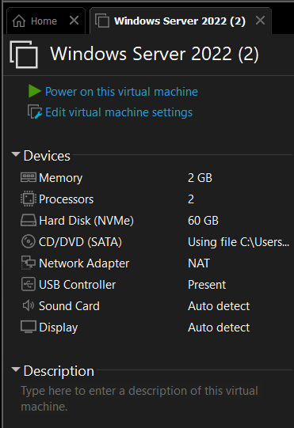
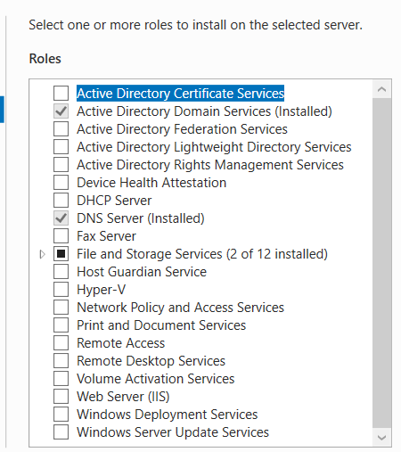
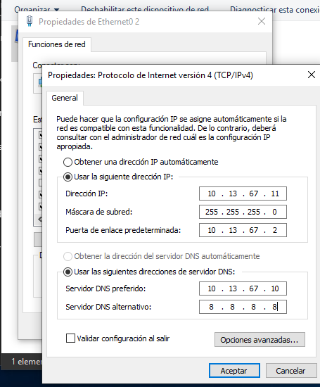
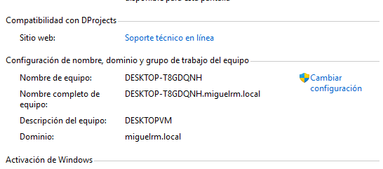
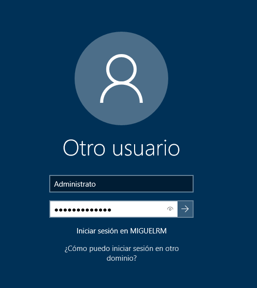

# Operating Systems Security - Practice 1 / Seguridad de Sistemas Operativos - Práctica 1

[English](#english) | [Español](#espanol)

---

# English

## Evidence of implementation

| Field | Detail |
|---|---|
| **Student** | Miguel Ramirez Meli |
| **Student ID** | 20251367 |
| **Career** | Information Security |
| **Institution** | Instituto Tecnológico de Las Américas (ITLA) |
| **Course** | Operating Systems Security |
| **Instructor** | Juan Alexander Ramírez |
| **Date** | 2026-01-25 |

## Evidence index

| No. | Evidence | Part | Status |
|---|---|---|---|
| 1 | Virtual machine hardware (VMware) | A |  |
| 2 | Active Directory Domain Services and DNS Server roles installed | B |  |
| 3 | Client network and DNS configuration | C |  |
| 4 | Client computer joined to the domain `miguelrm.local` | C |  |
| 5 | Sign-in screen showing the MIGUELRM domain | C |  |

---

### Evidence 1 - Virtual machine on VMware

The Windows Server 2022 virtual machine with 2 GB of memory, 2 processors, a 60 GB NVMe disk and a NAT network adapter.

### Evidence 2 - Installed server roles

Active Directory Domain Services and DNS Server shown as installed on the server.

### Evidence 3 - Client network configuration

Windows 10 client with IP 10.13.67.11 and the domain controller (10.13.67.10) set as preferred DNS server.

### Evidence 4 - Domain membership

The client computer reports the full name `DESKTOP-T8GDQNH.miguelrm.local` and the domain `miguelrm.local`.

### Evidence 5 - Domain sign-in

The sign-in screen of the client offers sign-in to the MIGUELRM domain.

---

# Español

## Evidencia de implementación

| Campo | Detalle |
|---|---|
| **Estudiante** | Miguel Ramirez Meli |
| **Matrícula** | 20251367 |
| **Carrera** | Seguridad Informática |
| **Institución** | Instituto Tecnológico de Las Américas (ITLA) |
| **Materia** | Seguridad de Sistemas Operativos |
| **Instructor** | Juan Alexander Ramírez |
| **Fecha** | 25-01-2026 |

## Índice de evidencias

| N.º | Evidencia | Punto | Estado |
|---|---|---|---|
| 1 | Hardware de la máquina virtual (VMware) | A |  |
| 2 | Roles Servicios de dominio de Active Directory y Servidor DNS instalados | B |  |
| 3 | Configuración de red y DNS del cliente | C |  |
| 4 | Equipo cliente unido al dominio `miguelrm.local` | C |  |
| 5 | Pantalla de inicio de sesión con el dominio MIGUELRM | C |  |

---

### Evidencia 1 - Máquina virtual en VMware

La máquina virtual de Windows Server 2022 con 2 GB de memoria, 2 procesadores, disco NVMe de 60 GB y adaptador de red NAT.

### Evidencia 2 - Roles instalados en el servidor

Servicios de dominio de Active Directory y Servidor DNS aparecen como instalados en el servidor.

### Evidencia 3 - Configuración de red del cliente

Cliente Windows 10 con la IP 10.13.67.11 y el controlador de dominio (10.13.67.10) como servidor DNS preferido.

### Evidencia 4 - Pertenencia al dominio

El equipo cliente muestra el nombre completo `DESKTOP-T8GDQNH.miguelrm.local` y el dominio `miguelrm.local`.

### Evidencia 5 - Inicio de sesión en el dominio

La pantalla de inicio de sesión del cliente permite iniciar sesión en el dominio MIGUELRM.

---

