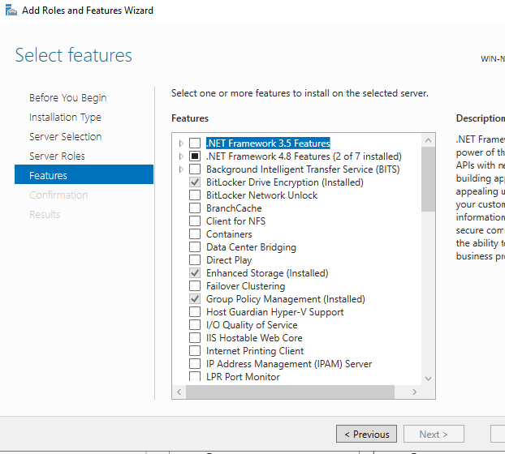
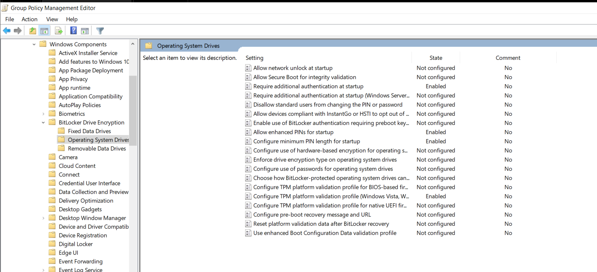
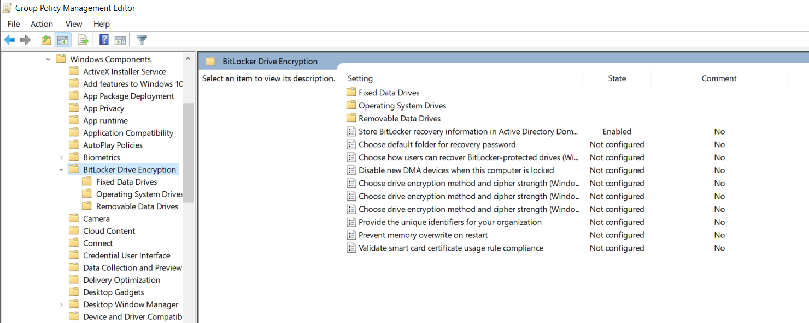
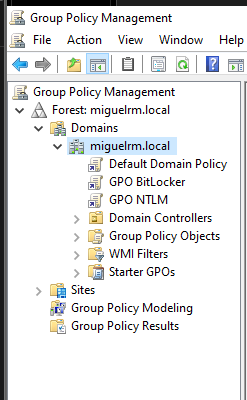
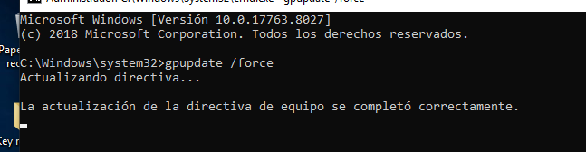
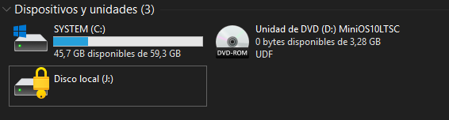
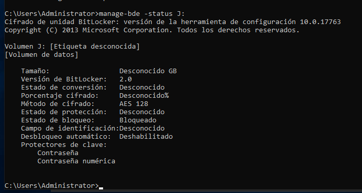
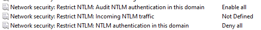

# Seguridad de Sistemas Operativos - Práctica 2

---

## Evidencia de implementación

| Campo | Detalle |
|---|---|
| **Estudiante** | Miguel Ramirez Meli |
| **Matrícula** | 20251367 |
| **Carrera** | Seguridad Informática |
| **Institución** | Instituto Tecnológico de Las Américas (ITLA) |
| **Materia** | Seguridad de Sistemas Operativos |
| **Instructor** | Juan Alexander Ramírez |
| **Fecha** | 01-02-2026 |

## Índice de evidencias

| N.º | Evidencia | Punto | Estado |
|---|---|---|---|
| 1 | Característica Cifrado de unidad BitLocker instalada en el servidor | A |  |
| 2 | Directivas de BitLocker para unidades del sistema operativo | A |  |
| 3 | Información de recuperación almacenada en Active Directory | A |  |
| 4 | GPO BitLocker y GPO NTLM vinculadas al dominio | A, B |  |
| 5 | Directiva de grupo actualizada en el cliente | A, B |  |
| 6 | Unidad protegida con BitLocker (bloqueada) | A |  |
| 7 | Estado de BitLocker de la unidad (`manage-bde`) | A |  |
| 8 | Directivas de restricción de NTLM | B |  |

---

## Punto A - GPO BitLocker

### Evidencia 1 - Característica BitLocker instalada

Cifrado de unidad BitLocker aparece como instalado en el asistente de roles y características del servidor.

### Evidencia 2 - Directivas de BitLocker para unidades del sistema operativo

En el editor de la GPO, "Require additional authentication at startup", "Allow enhanced PINs for startup", "Configure minimum PIN length for startup" y el perfil de validación de plataforma del TPM están en Enabled.

### Evidencia 3 - Información de recuperación en Active Directory

"Store BitLocker recovery information in Active Directory Domain Services" está en Enabled.

### Evidencia 4 - GPO vinculadas al dominio

Administración de directivas de grupo muestra GPO BitLocker y GPO NTLM creadas y vinculadas al dominio `miguelrm.local`.

### Evidencia 5 - Actualización de directivas en el cliente

`gpupdate /force` se completó correctamente en el equipo cliente.

### Evidencia 6 - Unidad protegida con BitLocker

La unidad J: aparece con el candado cerrado, lo que indica que está protegida y bloqueada por BitLocker.

### Evidencia 7 - Estado de BitLocker

`manage-bde -status J:` reporta BitLocker versión 2.0, cifrado AES 128, estado de bloqueo Bloqueado y los protectores de clave Contraseña y Contraseña numérica.

---

## Punto B - GPO NTLM

### Evidencia 8 - Directivas de restricción de NTLM

"Restrict NTLM: Audit NTLM authentication in this domain" está en Enable all, y "Restrict NTLM: NTLM authentication in this domain" está en Deny all.

---

