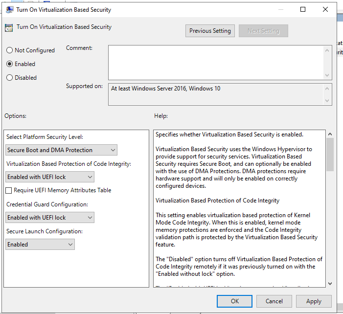
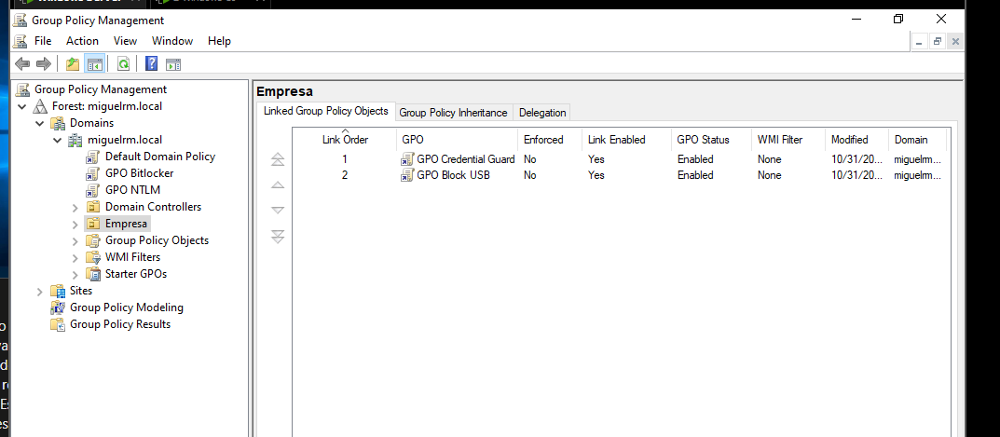
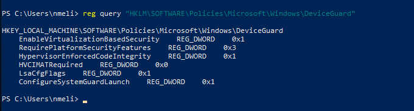
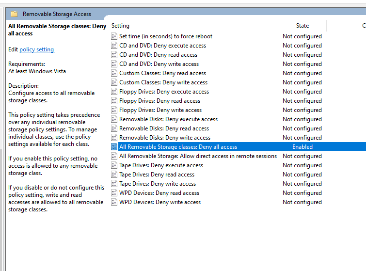
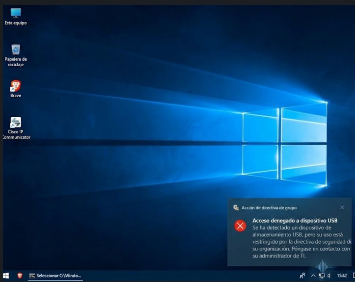

# Seguridad de Sistemas Operativos - Práctica 3

---

## Evidencia de implementación

| Campo | Detalle |
|---|---|
| **Estudiante** | Miguel Ramirez Meli |
| **Matrícula** | 20251367 |
| **Carrera** | Seguridad Informática |
| **Institución** | Instituto Tecnológico de Las Américas (ITLA) |
| **Materia** | Seguridad de Sistemas Operativos |
| **Instructor** | Juan Alexander Ramírez |
| **Fecha** | 08-02-2026 |

## Índice de evidencias

| N.º | Evidencia | Punto | Estado |
|---|---|---|---|
| 1 | Directiva de seguridad basada en virtualización habilitada | A |  |
| 2 | GPO Credential Guard y GPO Block USB vinculadas a la unidad organizativa Empresa | A, C |  |
| 3 | Valores de Device Guard aplicados en el registro del cliente | A |  |
| 4 | Directiva de almacenamiento extraíble habilitada | C |  |
| 5 | Dispositivo USB bloqueado en el cliente | C |  |

---

## Punto A - GPO Credential Guard

### Evidencia 1 - Seguridad basada en virtualización

La directiva "Turn On Virtualization Based Security" está en Enabled, con nivel de plataforma Secure Boot and DMA Protection, protección de integridad de código y Credential Guard en "Enabled with UEFI lock", y Secure Launch en Enabled.

### Evidencia 2 - GPO vinculadas a la unidad organizativa Empresa

Administración de directivas de grupo muestra GPO Credential Guard y GPO Block USB vinculadas a la unidad organizativa `Empresa` del dominio `miguelrm.local`, con el enlace habilitado y el estado de la GPO en Enabled.

### Evidencia 3 - Despliegue de la política en el cliente

La consulta `reg query` sobre la clave `HKLM\SOFTWARE\Policies\Microsoft\Windows\DeviceGuard` del cliente muestra `EnableVirtualizationBasedSecurity` en 0x1, `RequirePlatformSecurityFeatures` en 0x3, `HypervisorEnforcedCodeIntegrity` en 0x1, `LsaCfgFlags` en 0x1 y `ConfigureSystemGuardLaunch` en 0x1.

---

## Punto C - GPO Block USB

### Evidencia 4 - Directiva de almacenamiento extraíble

La directiva "All Removable Storage classes: Deny all access" está en Enabled dentro de Removable Storage Access.

### Evidencia 5 - USB bloqueado en el cliente

El cliente muestra la notificación "Acción de directiva de grupo: Acceso denegado a dispositivo USB", que indica que el dispositivo de almacenamiento fue detectado pero su uso está restringido por la directiva de seguridad de la organización.

---

